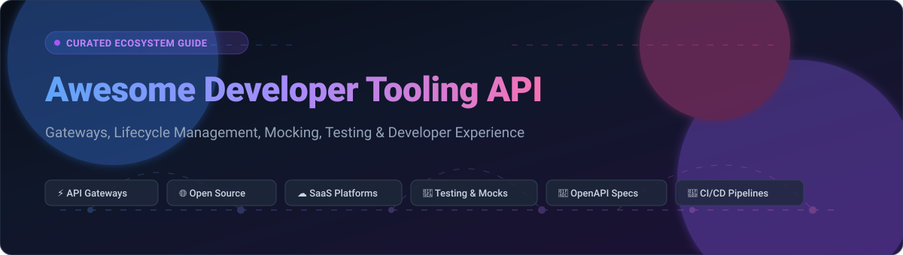

  
  
  
  
  
  

  

# 🚀 Awesome-Developer-Tooling-API

> 🌟 **The Definitive Directory of Developer Tooling APIs, API Gateways, Lifecycle Management, and Developer Experience (DevEx) Ecosystems.**

Welcome to **Awesome Developer Tooling API** — an SEO-optimized, community-curated catalog indexing top **SaaS platforms** and high-velocity **open-source GitHub projects** powering modern API engineering. Whether you are architecting a cloud-native microservice API gateway, establishing contract testing in CI/CD pipelines, generating OpenAPI SDKs, or seeking transparent self-hosted developer tools, this index provides deep technical coverage, real-time metrics, and verified commercial tiers.

---

## 📑 Table of Contents

- [🌐 Sector Overview & Market Dynamics](#-sector-overview--market-dynamics)
- [☁️ SaaS / Hosted Platforms](#️-saas--hosted-platforms)
- [💻 Open-Source GitHub Projects](#-open-source-github-projects)
- [📈 Star History](#-star-history)
- [🤝 How to Contribute](#-how-to-contribute)
- [💖 Support & Sponsorship](#-support--sponsorship)
- [⚖️ Disclaimer](#️-disclaimer)

---

## 🌐 Sector Overview & Market Dynamics

The global API management and developer tooling market is estimated at approximately **$8.6B to $10.5B** and projected to surpass **$30B+ by the early 2030s** (growing at an ~18–22% CAGR). The sector exhibits a **dual dynamic**: it is **moderately concentrated** at the enterprise infrastructure layer (where hyperscalers and incumbents like Microsoft/GitHub, Salesforce/MuleSoft, and Google Cloud command over 50% of market share), yet **highly fragmented** in specialized developer experience niches (such as API testing, edge platforms, and collaborative API design) where product-led, developer-first startups compete vigorously.

---

## ☁️ SaaS / Hosted Platforms

| Product | Company Size (Valuation / Revenue) | Starting Paid Tier Pricing | Free Tier / Free Trial Limits | API Description |
| :--- | :--- | :--- | :--- | :--- |
| **[Salesforce Tooling API](https://developer.salesforce.com/docs/atlas.en-us.api_tooling.meta/api_tooling/)** | ~$280B Market Cap (~$38B ARR) | $25/user/month (Starter Suite) | 30-day full-feature trial (includes REST/Tooling API access) or free Developer Edition org (lifetime sandbox with 5MB data / 20MB file storage, max 15,000 API calls/24 hrs) | REST API for managing metadata about Apex classes, triggers, Visualforce pages, and development artifacts. Endpoints for querying/mutating tooling objects (`ApexClass`, `ApexTrigger`, `ApexLog`, `MetadataContainer`). Base URL: `https://{instance}.salesforce.com/services/data/v59.0/tooling`. |
| **[GitHub REST API](https://docs.github.com/rest)** | ~$100B+ Implied Value (Part of Microsoft $3T+ Cap; ~$2B+ ARR) | $4/user/month (Team plan) | $0 Free forever plan: unlimited public/private repositories, 2,000 GitHub Actions CI/CD minutes/month, 500MB Packages storage, and 5,000 API requests/hour authenticated (60 requests/hour unauthenticated). | Comprehensive REST API (version 2026-03-10) for managing repositories, issues, pull requests, actions, packages, and organization governance with OpenAPI descriptions and granular PAT permissions. |
| **[Bitbucket Cloud API](https://developer.atlassian.com/cloud/bitbucket/)** | ~$50B Market Cap (Atlassian; ~$4.4B ARR) | $3/user/month (Standard plan) | $0 Free forever plan: up to 5 user seats, 50 CI/CD build minutes/month, 1GB Git LFS storage, and unlimited private repositories with REST API access (1,000 requests/hr rate limit). | 2.0 REST API supporting Bitbucket Query Language (BBQL) for query filtering, partial field responses, and API proxy authentication. Built on OpenAPI Specification 2.0. |
| **[Vercel API](https://vercel.com/docs/rest-api)** | $9.3B Valuation (~$200M+ ARR) | $20/month per seat (Pro plan) | $0 Free Hobby plan (personal/non-commercial): 100GB fast data transfer/month, 1M Edge Requests/month, 1M Serverless Function invocations/month, 4 CPU-hours compute, and 1GB Blob storage. Hard-paused upon limit exhaustion. | REST API for managing deployments, project environments, custom domains, Edge/Serverless functions, Secure Compute networks, PrivateLink endpoints, and third-party integrations. |
| **[GitLab API](https://docs.gitlab.com/api/)** | ~$9B Market Cap (~$700M+ ARR) | $29/user/month (Premium plan) | $0 Free forever plan: up to 5 users/namespace, 400 CI/CD compute minutes/month, 5GB storage, 10GB transfer/month, and API rate limit of 2,000 requests/minute authenticated. | REST API (v4) managing projects, CI/CD pipelines, merge requests, container registries, and enterprise issue tracking. Supports offset/keyset pagination and token authentication. |
| **[Postman API](https://learning.postman.com/docs/)** | $5.6B Peak Valuation (~$313M ARR) | $9/user/month billed annually ($12 monthly - Solo plan) | $0 Free forever plan: 1 user seat, 50 Postman AI credits/month, unlimited collection runs, mock servers, and 1,000 Postman API requests/month. | REST API for programmatically managing workspace collections, environments, monitors, mock servers, and API definitions to integrate into automated CI/CD pipelines. |
| **[Travis CI API](https://docs.travis-ci.com/api/)** | ~$3B Valuation (Idera; ~$500M+ ARR) | $69/month (Core 1-concurrent job plan) | 14-day free trial with 10,000 trial build credits (~1,000 Linux build minutes) valid for trial duration; free credits pool renewable upon request for qualified open-source repositories. | API V3 for managing repositories, triggering builds, inspecting jobs, controlling environment variables, setting cron schedules, and validating `.travis.yml` files. |
| **[Docker Hub API](https://docs.docker.com/reference/api/hub/)** | $2.1B Valuation (~$207M ARR) | $9/user/month billed annually ($11 monthly - Pro plan) | $0 Docker Personal forever plan (organizations <250 employees and <$10M revenue): 200 image pulls per 6 hours (authenticated), unlimited public repositories, and 1 private repository. | API v2 for programmatic management of container repositories, webhooks, tags, teams, and access tokens, coupled with Registry HTTP v2 API and Docker Scout CVE analysis endpoints. |
| **[CircleCI API](https://circleci.com/docs/api/)** | $1.7B Valuation (~$55M+ ARR) | $15/month (Performance plan, includes 30k credits + 5 seats) | $0 Free forever plan: 30,000 credits/month (~3,000 Linux medium build minutes), up to 5 user seats, and unlimited VCS integrations. | REST API for triggering pipelines, inspecting workflows/jobs, managing contexts and environment variables, and querying performance and test insights. |
| **[Netlify API](https://docs.netlify.com/api-and-cli-guides/api-guides/get-started-with-api/)** | $2.0B Valuation (~$45M ARR) | $9/month (Personal plan, includes 1,000 credits) | $0 Free forever plan: 300 credits/month (e.g., 20 credits/GB outbound transfer, 15 credits/production deploy, 2 credits/10k web requests), 1-day analytics retention, hard cap when monthly pool is consumed. | REST API for site deployments (including raw ZIP upload), DNS/domain automation, serverless and edge functions management, and form submissions. |

---

## 💻 Open-Source GitHub Projects

All repositories are dynamically tracked and ordered in **descending order by GitHub stargazers**. Click on any Stars_Badge to visit the project's stargazers community.

- **[hoppscotch](https://github.com/hoppscotch/hoppscotch)** 

  Open-source API development ecosystem. Ultra-fast, lightweight web & desktop alternative to Postman with WebSocket, GraphQL, and gRPC support.

- **[traefik](https://github.com/traefik/traefik)** 

  Modern HTTP reverse proxy and cloud-native edge router that integrates seamlessly with microservices, Docker, Kubernetes, and API gateway architectures.

- **[bruno](https://github.com/usebruno/bruno)** 

  Fast, Git-friendly, and offline-first open-source API client storing collections directly in your filesystem as plain-text Bru markup.

- **[kong](https://github.com/Kong/kong)** 

  World’s most popular cloud-native open-source microservice API gateway built on NGINX/OpenResty, with rich plugin ecosystems for auth, rate limiting, and observability.

- **[insomnia](https://github.com/Kong/insomnia)** 

  Leading open-source desktop API client and design platform for GraphQL, REST, WebSockets, Server-Sent Events (SSE), and gRPC APIs.

- **[directus](https://github.com/directus/directus)** 

  Open-source data platform that instantly wraps any SQL database with real-time REST and GraphQL developer tooling APIs with granular RBAC permissions.

- **[graphql-engine](https://github.com/hasura/graphql-engine)** 

  Blazing-fast instant GraphQL and REST APIs engine on PostgreSQL, MySQL, and SQL Server with built-in fine-grained row-level access control.

- **[k6](https://github.com/grafana/k6)** 

  Modern developer-centric load and performance testing tool for APIs, microservices, and websites with ES6 JavaScript scripting and CLI execution.

- **[envoy](https://github.com/envoyproxy/envoy)** 

  High-performance C++ cloud-native edge, service, and API data-plane proxy designed for microservices and cloud-native service meshes.

- **[swagger-ui](https://github.com/swagger-api/swagger-ui)** 

  HTML, JavaScript, and CSS visual documentation generator dynamically rendering interactive API consoles directly from OpenAPI / Swagger definitions.

- **[openapi-generator](https://github.com/OpenAPITools/openapi-generator)** 

  Extensible code generation engine generating API client SDKs, server stubs, OpenAPI documentation, and configuration from OpenAPI v2 and v3 specs across 50+ languages.

- **[dapr](https://github.com/dapr/dapr)** 

  Distributed Application Runtime providing event-driven, portable developer APIs (pub/sub, state management, service invocation, secrets) for microservices.

- **[redoc](https://github.com/Redocly/redoc)** 

  Open-source, responsive, and clean three-panel API documentation generator powered by OpenAPI/Swagger specifications with customizable themes.

- **[opik](https://github.com/comet-ml/opik)** 

  Open-source LLM observability, evaluation, and developer platform for monitoring, testing, logging, and debugging production AI agents and LLM APIs.

- **[apisix](https://github.com/apache/apisix)** 

  Dynamic, real-time, high-performance open-source cloud-native API gateway built on Nginx and etcd with hot-reloading plugins and routing capabilities.

- **[scalar](https://github.com/scalar/scalar)** 

  Modern, beautiful, and interactive offline-first API documentation platform, client, and reference generator for OpenAPI specifications.

- **[tyk](https://github.com/TykTechnologies/tyk)** 

  Open-source enterprise API gateway written in Go with an out-of-the-box developer portal, analytics engine, rate limiting, and token management.

- **[mockoon](https://github.com/mockoon/mockoon)** 

  Easiest and quickest way to run local mock REST APIs. Open-source, desktop application with JSON templating, proxy mode, and CLI runner.

- **[wiremock](https://github.com/wiremock/wiremock)** 

  Flexible HTTP mock engine for stubbing and verifying HTTP interactions in API integration and unit tests across JVM, standalone servers, and Docker.

- **[lura](https://github.com/luraproject/lura)** 

  Ultra high-performance open-source API gateway framework written in Go with linear scalability and composable middleware pipelines.

- **[prism](https://github.com/stoplightio/prism)** 

  Open-source HTTP mock server and proxy that turns OpenAPI specifications into realistic, contract-compliant mock APIs with automated validation.

- **[svix-webhooks](https://github.com/svix/svix-webhooks)** 

  Enterprise-ready open-source Webhooks-as-a-Service architecture providing reliable webhook delivery, retries, HMAC verification, and developer portals.

- **[formio](https://github.com/formio/formio)** 

  Enterprise-grade form building and data management platform generating RESTful developer APIs dynamically from drag-and-drop schemas.

- **[fusio](https://github.com/apioo/fusio)** 

  Open-source API management platform written in PHP helping teams build, manage, monitor, and document full-scale REST APIs with a developer portal.

- **[yaade](https://github.com/EsperoTech/yaade)** 

  Self-hosted, collaborative, and secure developer API workbench for creating, sharing, and executing HTTP requests with multi-user workspace support.

- **[pact-js](https://github.com/pact-foundation/pact-js)** 

  Consumer-driven contract testing framework for JavaScript/TypeScript APIs, preventing breaking changes between microservice consumers and providers.

- **[dreamfactory](https://github.com/dreamfactorysoftware/dreamfactory)** 

  Instant REST API generation engine that connects to any relational database or file storage system and auto-generates documented endpoints with RBAC.

- **[para](https://github.com/Erudika/para)** 

  Flexible, modular backend framework providing instant object persistence, search, and authentication REST APIs for web and mobile applications.

- **[graphweaver](https://github.com/exogee-technology/graphweaver)** 

  Instantly turn multiple enterprise data sources (Postgres, MySQL, SQLite, REST) into a unified GraphQL API without boilerplate code.

- **[api-client-tui](https://github.com/nutcas3/api-client-tui)** 

  Terminal-based interactive developer API client written in Go using Bubble Tea, featuring multi-panel TUIs, history tracking, and collections.

- **[aat](https://github.com/gburgyan/aat)** 

  Adaptive API Toolkit CLI for testing complex API workflows end-to-end with graph-based dependency resolution and AI-assisted plan generation.

- **[tainha-gateway](https://github.com/lusqua/tainha-gateway)** 

  Lightweight Go-based API gateway featuring path parameter routing, JWT token auth, response mapping, SSE passthrough, and Prometheus metrics.

- **[webscope](https://gitlab.com/manabug/webscope)**

  Lightweight developer API documentation generator for OpenAPI and Markdown specs with static HTML rendering and built-in HTTP server mode.

---

## 📈 Star History

---

## 🤝 How to Contribute

Contributions make the open-source community thrive! To add or update an API tool:

1. 🍴 **Fork the Project**
2. 🌿 **Create a Feature Branch** (`git checkout -b feature/AddAmazingTool`)
3. 📝 **Edit `README.md`** following existing formatting, including links, descriptions, and verified pricing/stargazer metadata
4. 💾 **Commit your Changes** (`git commit -m "Add Amazing Developer Tooling API"`)
5. 📤 **Push to Branch** (`git push origin feature/AddAmazingTool`)
6. 🚀 **Open a Pull Request**

Please ensure all descriptions are concise, technical, and link directly to official documentation.

---

## 💖 Support & Sponsorship

If you find this curated developer tooling ecosystem repository helpful, please consider showing your support:

- ⭐ **Star this repository** to help other developers discover it!
- 🍴 **Fork and share** it across your network and engineering teams!
- ☕ **Buy me a coffee / Sponsor**: Support ongoing maintenance and curation via the [GitHub Sponsors Dashboard](https://github.com/sponsors/ishandutta2007).

Your sponsorship directly funds ongoing index curation, automation tooling, and developer ecosystem research. Thank you! 🙌

---

## ⚖️ Disclaimer

- This is a community-curated directory intended for educational and reference purposes; listings do not represent formal endorsements.
- When deploying API platforms handling authentication tokens, sensitive customer data, or internal traffic, always ensure strict compliance with applicable regulatory frameworks (SOC 2, ISO 27001, GDPR, HIPAA).
- Self-hosted open-source software requires routine security audits, rate-limiting policies, TLS/mTLS configurations, and proactive patch management.

---

  Built with ❤️ for platform engineers, DevOps teams, backend developers, and API architects worldwide.

